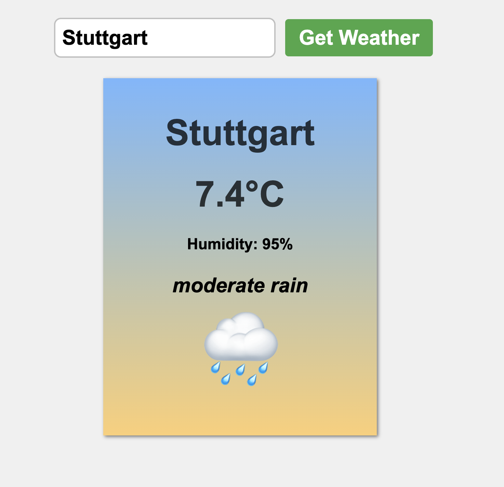
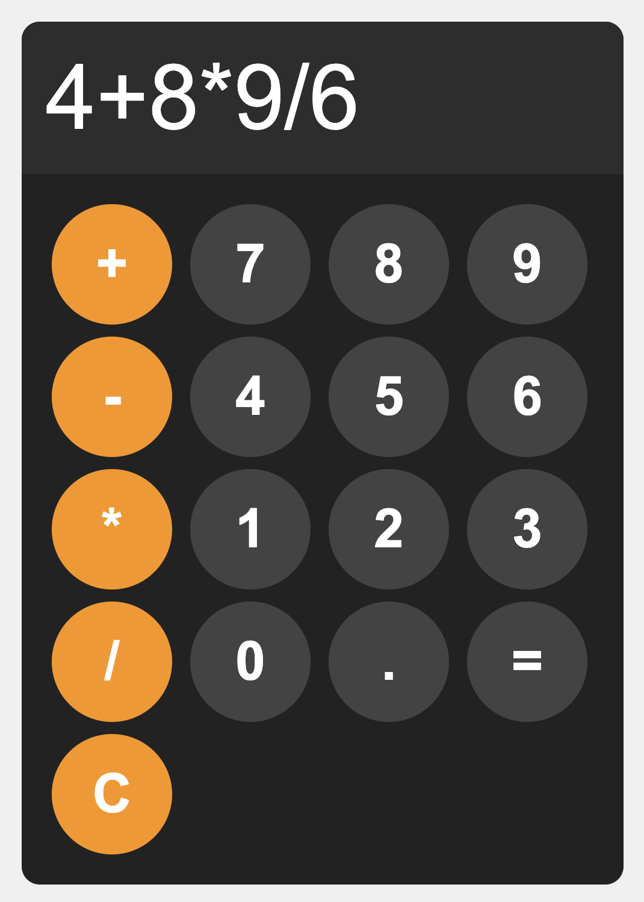
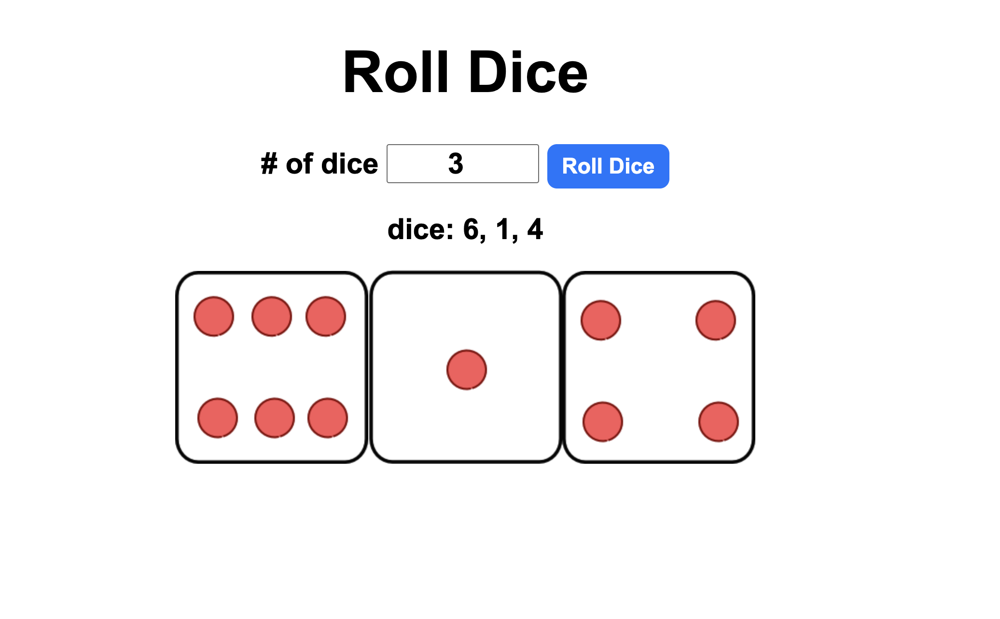
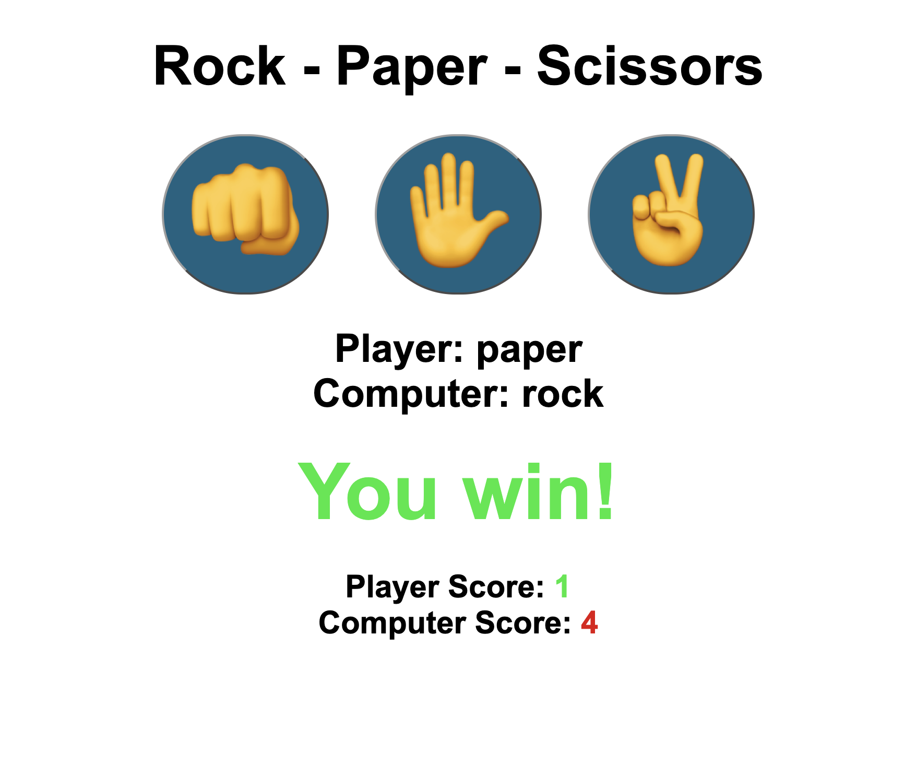
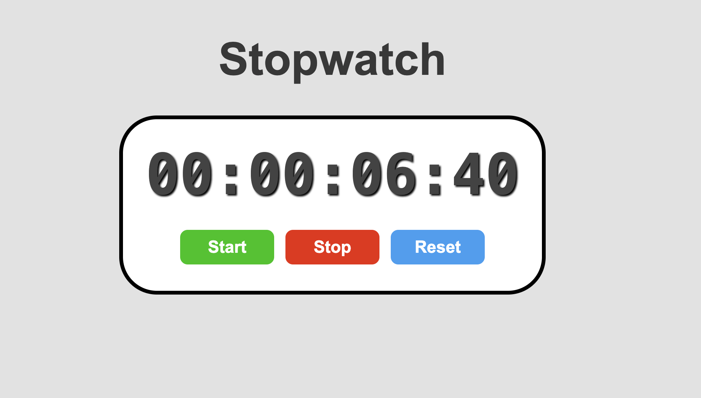
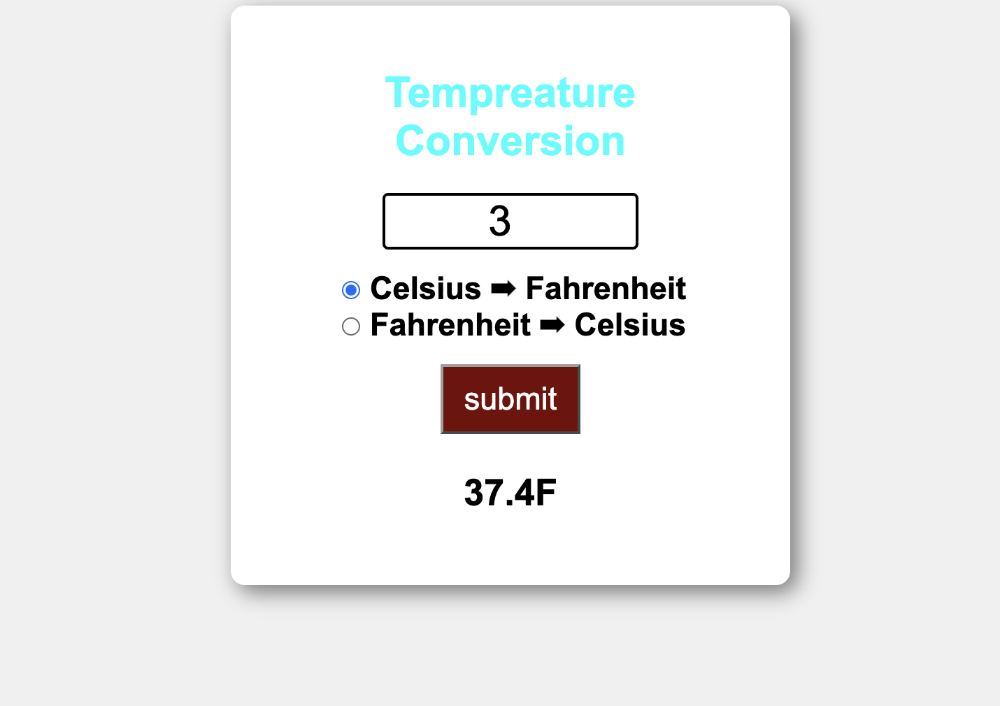

# JavaScript, HTML & CSS — Small Projects


A collection of small web applications built with plain (vanilla) **JavaScript, HTML and CSS**. They use no frameworks, no libraries and no build tools. Each project focuses on one core part of front-end development, from DOM manipulation and event handling to asynchronous requests against a real REST API.

The main project is the **[Weather App](#weather-app)**, which fetches live weather data from the OpenWeatherMap API. The smaller projects that follow it each practise one specific concept.

---

## Motivation

These projects are steps on my way to learning **JavaScript, HTML and CSS** so that I can build complete web applications. I wrote every project by hand, without frameworks, so that I understand every line and why it is there.

AI coding tools can now produce working code in seconds, so it is fair to ask whether learning a language in depth is still worth it. I believe it is. AI can write code, but a developer still has to understand **the logic behind the scenes**: how the DOM updates, how events flow, and how asynchronous code and error handling work. Without that understanding, you cannot judge, debug or extend what the AI produces. Learning the syntax and fundamentals takes a lot of time, and I see that time as an investment in real understanding, not a cost to avoid.

---

## Table of Contents

- [Projects Overview](#projects-overview)
- [Getting Started](#getting-started)
- [🌦️ Weather App (Featured)](#weather-app)
- [Small Projects](#small-projects)
  - [🧮 Calculator](#calculator)
  - [🎲 Dice Roller](#dice-roller)
  - [✊ Rock – Paper – Scissors](#rock-paper-scissors)
  - [⏱️ Stopwatch](#stopwatch)
  - [🌡️ Temperature Conversion](#temperature-conversion)
- [Repository Structure](#repository-structure)
- [Author](#author)

---

## Projects Overview

| Project | Description | Key Concepts |
|---|---|---|
| 🌦️ **[Weather App](#weather-app)** | Live weather for any city using the OpenWeatherMap API | `fetch`, `async/await`, error handling, destructuring, dynamic DOM |
| 🧮 [Calculator](#calculator) | Basic arithmetic calculator | Event handlers, CSS Grid |
| 🎲 [Dice Roller](#dice-roller) | Roll any number of dice, shown as images | `Math.random`, loops, generated HTML |
| ✊ [Rock – Paper – Scissors](#rock-paper-scissors) | Play against the computer, with a score counter | Conditionals, `switch`, `classList` |
| ⏱️ [Stopwatch](#stopwatch) | Start / stop / reset stopwatch | `setInterval`, `Date.now()`, string formatting |
| 🌡️ [Temperature Conversion](#temperature-conversion) | Convert between Celsius and Fahrenheit | Form inputs, radio buttons |

---

## Getting Started

You don't need to install anything. Every project runs directly in the browser.

```bash
git clone https://github.com/alm7h/JavaScript-HTML-CSS_Small-Projects.git
cd JavaScript-HTML-CSS_Small-Projects
```

Then open the `index.html` file of any project in your browser. For automatic reloading while you edit, you can use the [Live Server](https://marketplace.visualstudio.com/items?itemName=ritwickdey.LiveServer) extension for VS Code: right-click `index.html` and choose **"Open with Live Server"**.

> The Weather App needs a free API key before it can run. See [its setup steps](#how-to-run) below.

---

<a id="weather-app"></a>

## 🌦️ Weather App (Featured)

<p align="center">
  
</p>

*Searching for "Stuttgart" returns the live weather: 7.4 °C, 95 % humidity, "moderate rain" and a matching 🌧️ emoji, all on a card built with JavaScript.*

Search for any city and see its current weather: temperature, humidity, a short description and an emoji that matches the conditions. The data comes live from the **[OpenWeatherMap API](https://openweathermap.org/current)**.

### Features

- 🔎 **City search:** look up the current weather for any city by name.
- 🌡️ **Temperature in °C:** the API returns Kelvin, and the app converts it to Celsius.
- 💧 **Humidity and description:** for example *"light rain"* or *"clear sky"*.
- 😀 **Weather emojis:** OpenWeatherMap condition codes are mapped to emojis (⛈️ 🌧️ ❄️ 😶‍🌫️ ☀️ ☁️).
- ⚠️ **Error handling:** clear messages for an empty search, an unknown city or a failed request.
- 🎨 **Styled result card:** a gradient card that is built entirely with JavaScript.

### How It Works

```
User submits a city
        │
        ▼
getWeatherData(city) ──► fetch() OpenWeatherMap API (async/await)
        │
        ├── response not OK ──► throw Error ──► displayError()
        ▼
displayWeatherInfo(data)
        │   destructure JSON → { name, main: { temp, humidity }, weather: [{ description, id }] }
        │   create DOM elements → fill text → add CSS classes → append to card
        ▼
getWeatherEmoji(id) ──► emoji chosen from the condition-code range
```

1. The form's `submit` event is intercepted with `event.preventDefault()`, so the page doesn't reload.
2. `getWeatherData()` builds the request URL and calls the API with `fetch` and `async/await`.
3. The response status is checked (`response.ok`). If the request failed, an error is thrown and caught in a `try...catch` block.
4. `displayWeatherInfo()` uses **nested object and array destructuring** to pull out the needed fields, then builds the card with `createElement`, `classList` and `appendChild`.
5. `getWeatherEmoji()` uses a `switch (true)` pattern to map ID ranges (2xx thunderstorm, 5xx rain, 6xx snow, 800 clear, and so on) to an emoji.

### What I Learned

- Working with a **REST API** using the `fetch` API
- **Asynchronous JavaScript** with `async` / `await` and Promises
- **Error handling** with `try...catch` and HTTP status checks
- **Object and array destructuring** of nested JSON
- **Building DOM elements dynamically** instead of hard-coding HTML
- **Keeping secrets out of version control** with a config file and `.gitignore`
- Layout with **Flexbox** and styling with **linear gradients**

### How to Run

1. Create a free account at [openweathermap.org](https://openweathermap.org) and copy your API key (*Account → API keys*).
   New keys can take up to a couple of hours to become active.
2. Create your config file from the template:

   ```bash
   cp weather_app/config_EXAMPLE.js weather_app/config.js
   ```

3. Open `weather_app/config.js` and paste in your key:

   ```js
   const CONFIG = {
     API_KEY: "YOUR_API_KEY"
   };
   ```

4. Open `weather_app/index.html` in your browser and search for a city.

> **Note on the API key:** `config.js` is listed in `.gitignore`, so your key is never committed. The app runs entirely in the browser, though, so anyone using the page can still see the key. That is fine for a learning project. A production app would send its requests through a small backend that keeps the key secret.

### Project Files

```
weather_app/
├── index.html          # Search form and result card container
├── style.css           # Layout, form and card styling
├── index.js            # Fetching, parsing and rendering logic
├── config_EXAMPLE.js   # Template for your API key
└── config.js           # Your API key (git-ignored, you create this)
```

---

## Small Projects

Short exercises, each built to practise one concept.

<a id="calculator"></a>

### 🧮 Calculator

<p align="center">
  
</p>

*The display shows the expression `4+8*9/6`. Number keys are grey and operators are orange, all laid out in a CSS Grid.*

A basic calculator with `+ − × ÷`, decimal numbers and a clear button. The buttons are laid out with **CSS Grid**.

**Run:** open `calculator/index.html`

---

<a id="dice-roller"></a>

### 🎲 Dice Roller

<p align="center">
  
</p>

*Rolling 3 dice gives `6, 1, 4`, shown both as numbers and as dice images.*

Choose how many dice to roll and see each result as a number and as a dice image. Uses `Math.random()`, loops and generated HTML.

**Run:** open `dice_roller/index.html`

---

<a id="rock-paper-scissors"></a>

### ✊ Rock – Paper – Scissors

<p align="center">
  
</p>

*Paper beats rock, so a green "You win!" appears. The scores below are colored green for the player and red for the computer.*

Play against the computer. Wins and losses are shown in color, and the score is kept for both sides. Uses conditionals, `switch` and `classList`.

**Run:** open `rock_paper_scissors/index.html`

---

<a id="stopwatch"></a>

### ⏱️ Stopwatch

<p align="center">
  
</p>

*The stopwatch at 6.40 seconds (`00:00:06:40`), with Start, Stop and Reset buttons.*

A stopwatch with start, stop and reset, showing `HH:MM:SS:CC`. Uses `setInterval` together with `Date.now()`, so the elapsed time stays accurate.

**Run:** open `Stopwatch_Programm/index.html`

---

<a id="temperature-conversion"></a>

### 🌡️ Temperature Conversion

<p align="center">
  
</p>

*Converting 3 °C to Fahrenheit gives 37.4 °F. Pick a direction with the radio buttons and press submit.*

Enter a value and choose a direction to convert between Celsius and Fahrenheit. Practises form inputs and radio buttons.

**Run:** open `tempretatur_convertion/index.htm`

---

## Repository Structure

```
JavaScript-HTML-CSS_Small-Projects/
├── weather_app/              # 🌦️ Featured: live weather via OpenWeatherMap API
├── calculator/               # 🧮 Basic calculator
├── dice_roller/              # 🎲 Dice roller (with dice_images/)
├── rock_paper_scissors/      # ✊ Rock – Paper – Scissors game
├── Stopwatch_Programm/       # ⏱️ Stopwatch
├── tempretatur_convertion/   # 🌡️ Celsius ⇄ Fahrenheit converter
├── images/                   # Screenshots used in this README
└── README.md
```

Each project has the same three files: `index.html` (structure), `style.css` (presentation) and `index.js` (behaviour).

---

## Author

**[@alm7h](https://github.com/alm7h)**

If you find these projects useful or have suggestions, feel free to open an issue or leave a ⭐.
